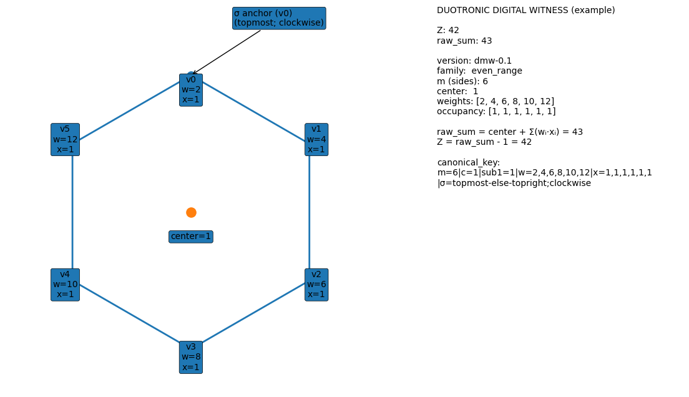

# Duotronic Bus Protocol (DBP)

DBP is a protocol family for secure real-time state and communications.

- Current canonical line: DBP v3 (`DBP3-F256 / F512 / F1024 / F2048 / F4096`)
- Status: DBP v3 draft development; v1.x and v2 references are retained

The fixed-shape Float32 frame described by the v1.x reference is a historical
wire format. It does not describe the v3 byte-native frame family.

## Historical DBP v1.x

DBP v1.x used a fixed 4096-byte frame of 1024 IEEE-754 Float32 cells for
real-time state fanout. Its fixed offsets traded per-frame overhead for simpler,
deterministic decoding.

That design is retained for existing v1.x implementations only. New protocol
work belongs in the current canonical DBP v3 line.

## DBP v3 Draft Line

DBP v3 is staged under `./protocol/v3/` as the current byte-native protocol
line. It defines a family of frame widths and adds secure sessions, records,
transactions, receipts, communications, and resilient federation.

Start here:

- v3 overview: `./protocol/v3/README.md`
- v3 specification: `./protocol/v3/docs/DBP-V3-SPEC.md`
- wire ABI: `./protocol/v3/docs/WIRE-ABI.md`
- release gates: `./protocol/v3/docs/RELEASE-GATES.md`
- changelog: `./protocol/v3/CHANGELOG.md`

The v3 reference implementation and conformance material live alongside the
specification in `./protocol/v3/`.


## Historical DBP v2 Draft Line

DBP v2 is retained under `./protocol/v2/` as a historical draft. It keeps the
fixed `4096` byte frame model and adds a Duotronics-aware semantic boundary:

```text
DBP frame validity != semantic validity != canonical identity != policy authority
```

Start here:

- v2 protocol reference: `./protocol/v2/duotronic-bus-v2.md`
- v2 S2 authority profile example: `./protocol/v2/profiles/dbp-duotronics-witness-authority-s2-v1.md`
- v2 full-duplex profile example: `./protocol/v2/profiles/dbp-full-duplex-witness-s2-mux-v1.md`
- migration guide: `./protocol/v2/migration-v1-to-v2.md`
- draft fixtures: `./protocol/v2/fixtures/dbp-v2-conformance-fixtures.yaml`

Conceptually, DBP is complementary to Duotronics: DBP protects and structures the bytes; Duotronics defines witness semantics, canonicalization, registry identity, normalizer behavior, recurrence gates, and policy authority after transport validation succeeds.

## Versioned Protocol Documents

DBP v3 is the current canonical source. The v1.x and v2 links below are
historical references retained for compatibility:

- Historical protocol reference (v1.x): `./protocol/duotronic-bus.md`
- Historical protocol draft (v2): `./protocol/v2/duotronic-bus-v2.md`
- Canonical protocol overview (v3): `./protocol/v3/README.md`
- Canonical protocol specification (v3): `./protocol/v3/docs/DBP-V3-SPEC.md`
- Wire ABI (v3): `./protocol/v3/docs/WIRE-ABI.md`
- Historical v2 S2 authority profile: `./protocol/v2/profiles/dbp-duotronics-witness-authority-s2-v1.md`
- Historical v2 full-duplex profile: `./protocol/v2/profiles/dbp-full-duplex-witness-s2-mux-v1.md`
- Duotronic Math v2 reference: `./protocol/ref/duotronic-math-v2.md`
- Legacy WSB2 reference encoder/decoder (JS): `./protocol/wsb2_ref.mjs`
- Legacy WSB2 reference encoder/decoder (Python): `./protocol/wsb2_ref.py`
- Legacy v1.1 snapshot archive: `./protocol/ref/duotronic-bus-spec-v1.1-legacy.md`

Companion working-theory paper:
- `./protocol/ref/A Framework for a Unified Data Model - From Quantum Mechanics to General Relativity via Duotronic Mathematics.md`

The detailed v1.x frame, security, band, and transport sections below describe
only the historical fixed-shape wire format. They are not requirements for DBP
v3.

## Historical Digital Witness Illustration (DMW 0.1)

The following illustration and vectors document a standalone DMW 0.1 example
associated with the older Float32 protocol material. They are not DBP v3 wire
conformance vectors or v3 Witness authority objects. DBP v3 treats Witness as
external canonical evidence; see `./protocol/v3/docs/WITNESS-CONTRACT.md`.

<p align="center">
  
  <br>
  <b>Figure:</b> Example digital witness geometry used in the optional Duotronic Math layer.
</p>

Historical v1.x/DMW example rules:
- Witness feature order is fixed and profile-governed.
- Token-free zero (`[0,0,0,0,0,0,0,0]`) means absence, not numeric zero.
- Structural DBP cells (header/trailer/footer and other profile-structural integer lanes) MUST NOT be witness-encoded.
- In historical v1.x/v2 ABB profiles, sparse transport may use `WSB2` over
  authenticated `opaque_bytes` lanes. This is not DBP v3 guidance.

Primary references:
- `./protocol/ref/duotronic-math-v2.md`
- `./protocol/wsb2_ref.mjs`
- `./protocol/wsb2_ref.py`

## Historical Frame Layout (v1.x only)

| Region | Cells | Bytes | Class |
|---|---:|---:|---|
| Band 0 (header) | `0..8` | `0..35` | Structural |
| Band 1 (lattice) | `9..19` | `36..79` | Semantic |
| Band 2 (Digital A) | `20..83` | `80..335` | Semantic |
| Band 3 (Digital B) | `84..147` | `336..591` | Semantic |
| Band 4 (quantum register) | `148..275` | `592..1103` | Semantic |
| Band 5 (waveform/digest) | `276..659` | `1104..2639` | Semantic |
| Band 6 (client/MUX) | `660..999` | `2640..3999` | Semantic/profile-structural |
| Band 6T (security trailer) | `1000..1019` | `4000..4079` | Structural |
| Band 7 (footer) | `1020..1023` | `4080..4095` | Structural |

### Core invariants

- Wire endianness is little-endian.
- Frame length MUST be exactly `4096` bytes.
- Structural fields MUST be raw integer-as-float where specified.
- Structural fields MUST NOT be witness-encoded.

## Security Profiles

- `sec_profile=0` Open: CRC only.
- `sec_profile=1` S1: authenticity + replay checks.
- `sec_profile=2` S2: confidentiality + authenticity + replay policy.

S2 high-level scope:
- ciphertext: cells `9..999`
- cleartext structural controls: Band 0, `1000..1003`, and policy cells `1018..1019`
- S2 AAD order: cells `0..8`, then `1000..1003`, then `1018..1019`

CRC policy:
- CRC32 is required in all modes.
- CRC flavor: `CRC-32/ISO-HDLC`.

## Integer-as-Float Decode Rule (critical)

For u16/u24 structural fields, receivers must verify:

1. finite
2. not subnormal
3. integral (no fractional part)
4. in range (`u16: 0..65535`, `u24: 0..16777215`)
5. round-trip exactness at Float32 precision

Hardened profile behavior:
- `-0.0` in structural integer fields is forbidden and rejected.

## Validation Pipeline (receiver)

Minimum strict order:

1. shape check (`4096` bytes)
2. structural integer preflight (`magic`, header/footer/trailer ints)
3. CRC verify over `bytes[0..4079]`
4. secure profile verification (S1 HMAC or S2 AEAD)
5. in S2, decrypt `9..999`
6. parse authenticated ABB manifest/MCB if present
7. derive `opaque_bytes` exclusion mask if used
8. numeric checks + semantic band decode

## Digital Channels and Capacity

Digital payload model:
- each `u24` cell carries 3 bytes
- each digital band has 64 cells, with 8-cell channel header
- payload per digital channel: `56 * 3 = 168` bytes
- base two-channel payload per frame: `336` bytes

## ABB (Adaptive Band Borrowing)

ABB lets profiles lease inactive donor bands without changing frame shape.

Donor bands:
- Band 4 (`148..275`)
- Band 5 (`276..659`)
- Band 6 (`660..999`)

Hard rules:
- no overlap with structural regions
- lease metadata must be authenticated
- native donor semantics take precedence
- in hardened MUX, fixed MCB occupies `660..683` and is non-borrowable

Lane types (hardened S2+MUX registry):
- `1 = digital_u24`
- `2 = analog_f32`
- `3 = quantum_pair`
- `4 = opaque_bytes` (S2 only)

### ABB capacity (digital_u24 mode)

- base digital (Band 2 + 3 payload): `336` bytes/frame
- + Band 4 max: `+384`
- + Band 5 max: `+1152`
- + Band 6 max: `+1020`
- theoretical max: `2892` bytes/frame

Hardened MUX adjustment:
- Band 6 effective borrow max: `316` cells (`948` bytes)
- hardened total with Band 4 + 5 + 6: `2820` bytes/frame

## Historical WSB2 Sparse Witness Transport (v1.x/v2 ABB extension)

WSB2 is a sparse witness payload format designed for v1.x/v2 ABB `opaque_bytes`
lanes. It is not part of the DBP v3 wire format or profile contract.

Use case:
- keep semantic model dense (`R x 8` witness rows),
- transport sparse present rows only,
- preserve constant-time lookup locally via `row_to_dense` index.

WSB2 payload structure:
- header `16` bytes:
  - `magic='WSB2'`
  - `version`
  - `overlay_id`
  - `rows=R`
  - `cols=8`
  - `present=K`
  - `flags`
- bitmap: `ceil(R/8)` bytes
- packed data: `K * 8 * 4` bytes (Float32 LE)
- optional body CRC32

Sizing:
- dense bytes: `R * 8 * 4`
- sparse bytes: `16 + ceil(R/8) + (K * 32)` (+ optional CRC)

Example:
- `R=64`, `K=8`
- dense: `2048` bytes
- sparse: `280` bytes

Reference implementations:
- JS: `./protocol/wsb2_ref.mjs`
- Python: `./protocol/wsb2_ref.py`

## Duotronic Math Layer (optional)

DBP can carry raw semantic values directly, or witness-based representations from Duotronic Math.

Core witness concepts:
- token-free zero means semantic absence,
- explicit numeric zero must not collapse to token-free zero,
- profile must define family mapping and decode contracts.

See:
- `./protocol/ref/duotronic-math-v2.md`

## Repo Layout

```text
protocol/
  duotronic-bus.md                    # Canonical protocol reference
  v2/                                 # DBP v2 draft line
  v3/                                 # DBP v3 draft, implementation and docs
  wsb2_ref.mjs                        # WSB2 JS reference
  wsb2_ref.py                         # WSB2 Python reference
  dbp_ref.mjs                         # Shared JS protocol helpers
  digital-witness.png                 # Visualization asset
  dmw_test_vectors.json               # Witness vectors
  DBP Profile Template.md             # Profile authoring template
  ref/
    duotronic-math-v2.md              # Canonical DM v2 reference
    duotronic-bus-spec-v1.1-legacy.md # Legacy archive
    A Framework for a Unified Data Model - From Quantum Mechanics to General Relativity via Duotronic Mathematics.md
```

## Quick Start

### 1) Verify WSB2 references

```bash
node protocol/wsb2_ref.mjs
python protocol/wsb2_ref.py
```

### 2) Read protocol first

- `protocol/duotronic-bus.md`

### 3) Read semantic layer

- `protocol/ref/duotronic-math-v2.md`

## Implementation Checklist (condensed)

- parse exactly `4096` bytes
- validate structural integer-as-float fields strictly
- verify CRC in all modes
- verify S1/S2 before semantic trust
- enforce replay and downgrade policy in hardened profiles
- in S2 + ABB `opaque_bytes`, exclude leased slices from float-class checks
- decode semantic bands only after all required checks pass

## Known Operational Guidance

- Atomic publish recommended (`write temp -> rename`).
- For pull transport, prefer ETag validation.
- For high fanout, SSE/WebSocket relay can reduce latency.
- Keep key rotation/replay state durable in hardened secure deployments.

## Compatibility and Evolution

- DBP v3 is the canonical protocol for current and future development; see
  `protocol/v3/README.md` and `protocol/v3/docs/DBP-V3-SPEC.md`.
- v1.x and v2 materials remain available as versioned historical references
  for compatibility and research. They do not define the v3 wire protocol.
- Earlier protocol versions and the v3 draft are covered by the repository's
  dual license.

## License

The entire repository is dual-licensed under MIT or Apache-2.0, at your
option. See `LICENSE`, `LICENSE-MIT`, and `LICENSE-APACHE`.


### Historical DBP v2 layout

```text
protocol/v2/
  duotronic-bus-v2.md                  # Main DBP v2 draft specification
  migration-v1-to-v2.md                # Migration guide from v1.x
  profiles/                            # Production and full-duplex v2 profiles
  schemas/                             # Draft JSON schema skeletons
  fixtures/                            # Draft conformance fixtures
  ref/                                 # Constants and source alignment notes
```
